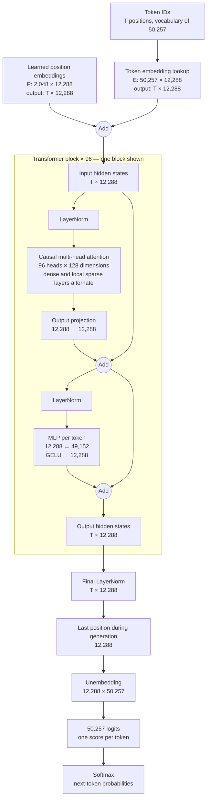

# Generative Pre-trained Transformer

## Goal

- Predict the **next token** (a token may be a word, part of a word, or punctuation).
- Each token starts as a lookup from the token embedding matrix. Transformer blocks progressively build a **contextual hidden state** for that token. The hidden state has `d_model` coordinates; these are features, not words or layers.
- Causal attention lets a position use itself and earlier positions, never later positions.

## Forward pass (decoder-only GPT)

1. **Tokenize and embed.** For token IDs $t_1,\ldots,t_T$, look up $E[t_i]$ and add a learned position embedding $P[i]$ (GPT-2/GPT-3): $H^{(0)}_i=E[t_i]+P[i]$. The embedding arithmetic examples are useful intuition, but are not exact identities or a guarantee for every word pair.
2. **Repeat transformer blocks.** Each block has multi-head causal self-attention and a position-wise MLP. Layer normalization comes *before* each sub-block, and a residual connection adds each sub-block's output back to the stream. In shorthand:
   - $U=H+\operatorname{MHA}(\operatorname{LN}(H))$
   - $H'=U+\operatorname{MLP}(\operatorname{LN}(U))$
3. **Normalize and unembed.** After the final normalization, project each position's hidden state to vocabulary-sized **logits**. During generation, use the last position's logits to choose the next token. Applying softmax turns logits into a probability distribution.

### One attention head

Let $X$ be the current block's normalized hidden states (one row per token). For one head:

- $Q=XW_Q$, $K=XW_K$, $V=XW_V$.
- The score $q_i\cdot k_j$ is a learned compatibility score for position $i$ reading position $j$; it is not necessarily a human-interpretable measure of how related two words are.
- Divide scores by $\sqrt{d_{\text{head}}}$ to control their scale. Set scores for $j>i$ to $-\infty$ with a causal mask.
- $A=\operatorname{softmax}\!\left(QK^\top/\sqrt{d_{\text{head}}}+M\right)$ and $Z=AV$.
- Concatenate all heads' $Z$ matrices, then apply an **output projection** $W_O$ back to $d_{\text{model}}$ dimensions. Each head has its own Q/K/V projections; all heads' outputs are combined by $W_O$.

### Position-wise MLP (GPT-2/GPT-3)

For each token independently, $\operatorname{MLP}(x)=\operatorname{GELU}(xW_{\text{up}}+b_{\text{up}})W_{\text{down}}+b_{\text{down}}$. The same MLP weights are reused at every sequence position. The intermediate width is $4d_{\text{model}}$. **GELU**, rather than ReLU, is used in GPT-2/GPT-3. Attention mixes information across positions; the MLP transforms each position's features.

### Training versus generation

- During training, the model predicts the next token at **every** input position in parallel. The causal mask prevents a position from seeing its target token.
- During generation, only the last position's logits are needed to select the next token; the process repeats with that token appended.
- A context window of $T$ tokens means the hidden-state array has shape $T\times d_{\text{model}}$ for one sequence. $T$ can be **up to** the context limit, not always exactly that size.

## GPT-2 small structure

- $d_{\text{model}}=768$, 12 layers, 12 attention heads, $d_{\text{head}}=64$, context limit 1,024 tokens. Other GPT-2 sizes have different widths and depths.

## GPT-3 175B structure

- **Announced:** May 28, 2020, with the GPT-3 paper. GPT-3-backed API access began in private beta on June 11, 2020; the weights were not publicly released.
- Approximately 175 billion trainable parameters; 96 transformer blocks; $d_{\text{model}}=12{,}288$; 96 heads per block; $d_{\text{head}}=128$; MLP width $49{,}152$; context limit 2,048 tokens.
- GPT-3 follows GPT-2's pre-normalized decoder architecture, with **alternating dense and locally banded sparse attention** across layers. The equations above show a dense attention head; a sparse layer also masks out positions outside its allowed band.
- GPT-2's implementation ties the token embedding and output projection weights. The GPT-3 paper says it otherwise follows GPT-2, but does not explicitly confirm weight tying. The table below **assumes** tying and counts that shared matrix once.

### Model diagram

The diagram follows one sequence of $T\leq2{,}048$ tokens. The block drawn inside the box is repeated **96 times**, with different learned weights in each block. Every residual stream has width 12,288.

The unembedding is shown as a separate *operation*. Under the weight-tying assumption used in the parameter table, it reads the token embedding matrix transposed rather than adding another set of trainable weights. During training, unembedding is applied at **every** position; the diagram shows the last position used for generation.

| Parameter group | Shape / calculation | Approximate count |
| --- | --- | ---: |
| Token embedding / tied output | $50{,}257\times12{,}288$ | 0.618B |
| Q projection, all layers | $96\times(12{,}288\times12{,}288)$ | 14.50B |
| K projection, all layers | Same as Q | 14.50B |
| V projection, all layers | Same as Q | 14.50B |
| Attention output projection, all layers | Same as Q | 14.50B |
| MLP up projection, all layers | $96\times(12{,}288\times49{,}152)$ | 57.98B |
| MLP down projection, all layers | $96\times(49{,}152\times12{,}288)$ | 57.98B |
| **Subtotal shown** | Excludes small bias, normalization, and position-embedding terms | **174.56B** |

The table is a **parameter count**, not the number of physical matrices in a particular implementation. Each Q/K/V row represents the projections across all heads and layers. The MLP up-projection bias has $49{,}152$ entries per layer; the down-projection bias has $12{,}288$.

## Llama 3 8B structure (open-weight comparison)

**Released:** April 18, 2024.

Llama 3 8B is a decoder-only transformer with downloadable weights under Meta's Llama 3 license. Its core next-token prediction flow is the same, but several block details differ from GPT-3.

| Feature                        |                          GPT-3 175B |                                                  Llama 3 8B |
| ------------------------------ | ----------------------------------: | ----------------------------------------------------------: |
| Transformer blocks             |                                  96 |                                                          32 |
| Model width $d_{\text{model}}$ |                              12,288 |                                                       4,096 |
| Context limit                  |                        2,048 tokens |                                                8,192 tokens |
| Vocabulary size                |                              50,257 |                                                     128,256 |
| Query heads                    |                                  96 |                                                          32 |
| Key/value heads                |                             96 each |                                                      8 each |
| Head width                     |                                 128 |                                                         128 |
| MLP hidden width               |                              49,152 |                                                      14,336 |
| Position method                | Learned absolute position embedding |                 Rotary position embedding (RoPE) on Q and K |
| Normalization                  |                           LayerNorm |                                                     RMSNorm |
| MLP activation                 |                                GELU | SwiGLU ($\operatorname{SiLU}(xW_1)\odot(xW_3)$, then $W_2$) |

### What changes in a Llama 3 block?

- **RoPE:** Position information rotates query and key vectors before attention scores are computed. There is no learned absolute position-embedding table added to token embeddings.
- **Grouped-query attention (GQA):** 32 query heads share 8 key heads and 8 value heads. Four query heads use each K/V head. This reduces K/V projection weights and the inference key/value cache. The output still has 32 heads, concatenated and projected back to 4,096 dimensions.
- **RMSNorm and residuals:** Each attention and MLP sub-block receives a normalized input, and its output is added to the residual stream; a final RMSNorm precedes the output projection.
- **SwiGLU MLP:** Two projections go up to 14,336 dimensions. One branch passes through SiLU, then multiplies the other branch elementwise; a third projection goes back down to 4,096. Unlike GPT-3's MLP, these projections have no biases in Meta's reference implementation.
- **Separate output weights:** Meta's reference implementation has a distinct output projection, rather than tying it to the token embedding weights.

| Parameter group | Shape / calculation | Approximate count |
| --- | --- | ---: |
| Token embedding | $128{,}256\times4{,}096$ | 0.525B |
| Q projection, all layers | $32\times(4{,}096\times4{,}096)$ | 0.537B |
| K projection, all layers | $32\times(4{,}096\times1{,}024)$ | 0.134B |
| V projection, all layers | Same as K | 0.134B |
| Attention output projection, all layers | Same as Q | 0.537B |
| MLP gate, up, and down, all layers | $3\times32\times(4{,}096\times14{,}336)$ | 5.637B |
| Separate output projection | $4{,}096\times128{,}256$ | 0.525B |
| RMSNorm weights | $2\times32\times4{,}096+4{,}096$ | 0.00027B |
| **Total** | | **8.030B** |

The K/V width is $8\times128=1{,}024$; the query/output width is $32\times128=4{,}096$. RoPE itself adds no learned weights.

## Qwen3-8B structure (open-source comparison)

**Released:** April 29, 2025, under the Apache 2.0 license.

Qwen3-8B is another **dense decoder-only transformer**, so it is a direct architectural comparison with Llama 3 8B. The 8B name is rounded: the model card reports about 8.2 billion parameters.

| Feature | Llama 3 8B | Qwen3-8B |
| --- | ---: | ---: |
| Transformer blocks | 32 | 36 |
| Model width $d_{\text{model}}$ | 4,096 | 4,096 |
| Vocabulary slots in embedding matrix | 128,256 | 151,936 |
| Native context length | 8,192 tokens | 32,768 tokens |
| Extended context | — | 131,072 tokens with YaRN RoPE scaling |
| Query heads | 32 | 32 |
| Key/value heads | 8 each | 8 each |
| Head width | 128 | 128 |
| MLP hidden width | 14,336 | 12,288 |
| Position method | RoPE | RoPE |
| Main normalization | RMSNorm | RMSNorm, plus QK-Norm |
| MLP | SwiGLU | SwiGLU |
| Token embedding / output weights | Separate | Separate |

### What changes from Llama 3 8B?

- **QK-Norm:** Qwen3 applies an extra RMS normalization to each query and key head before attention. This controls the scale of Q/K vectors before their dot products. It is distinct from softmax, which turns the resulting attention scores into weights that sum to one.
- **Same GQA arrangement:** 32 query heads share 8 key/value heads (four query heads per K/V head). Q output width is $32\times128=4{,}096$; K and V projection widths are each $8\times128=1{,}024$.
- **Same MLP pattern, different width:** The SwiGLU gate and up projections each go from 4,096 to 12,288 dimensions, and the down projection returns to 4,096. The three projections have no bias in the published configuration.
- **Longer context:** 32,768 tokens is the native pretraining length. Qwen documents 131,072 tokens with YaRN scaling; that extension requires the appropriate runtime configuration. The model's default configuration reserves 40,960 positions for typical prompt-plus-generation allocation, which is not a separate pretraining length.
- **Separate unembedding:** The output projection is an independent trainable matrix, so the token embedding and unembedding are both counted below. RoPE itself has no learned position-embedding matrix.

| Parameter group | Shape / calculation | Approximate count |
| --- | --- | ---: |
| Token embedding | $151{,}936\times4{,}096$ | 0.622B |
| Q projection, all layers | $36\times(4{,}096\times4{,}096)$ | 0.604B |
| K projection, all layers | $36\times(4{,}096\times1{,}024)$ | 0.151B |
| V projection, all layers | Same as K | 0.151B |
| Attention output projection, all layers | Same as Q | 0.604B |
| MLP gate, up, and down, all layers | $3\times36\times(4{,}096\times12{,}288)$ | 5.436B |
| Separate output projection | $4{,}096\times151{,}936$ | 0.622B |
| Main RMSNorm + QK-Norm weights | $(2\times36+1)\times4{,}096+2\times36\times128$ | 0.00031B |
| **Total from these dimensions** | | **8.191B** |

The tokenizer uses 151,669 token IDs in the technical report, while the embedding matrix has 151,936 slots in the published model configuration. The latter is the correct number for counting embedding and unembedding parameters. Qwen3-8B also supports *thinking* and *non-thinking* output modes through its chat template; these use the same model weights rather than two architectures.

## Softmax

For logits $x_1,\ldots,x_n$, $p_i=e^{x_i}/\sum_j e^{x_j}$. Each $p_i$ is positive and the probabilities sum to 1. Numerically, implementations usually subtract $\max_j x_j$ before exponentiating; this gives the same probabilities and avoids overflow.

## Sources

- [GPT-3 paper, §2.1 and Table 2.1](https://arxiv.org/pdf/2005.14165)
- [OpenAI's GPT-3 announcement](https://openai.com/index/language-models-are-few-shot-learners/) and [2020 API beta announcement](https://openai.com/index/openai-api/)
- [GPT-2 paper, §2](https://cdn.openai.com/better-language-models/language-models.pdf) and [OpenAI GPT-2 reference code](https://github.com/openai/gpt-2/blob/master/src/model.py)
- [Meta's Llama 3 release announcement](https://ai.meta.com/blog/meta-llama-3), [model card](https://github.com/meta-llama/llama3/blob/main/MODEL_CARD.md), and [reference implementation](https://github.com/meta-llama/llama3/blob/main/llama/model.py)
- [Qwen3 release announcement](https://qwenlm.github.io/blog/qwen3/), [technical report](https://arxiv.org/pdf/2505.09388), [Qwen3-8B model card and configuration](https://huggingface.co/Qwen/Qwen3-8B), and [long-context documentation](https://github.com/QwenLM/Qwen3/blob/main/docs/source/inference/transformers.md)
